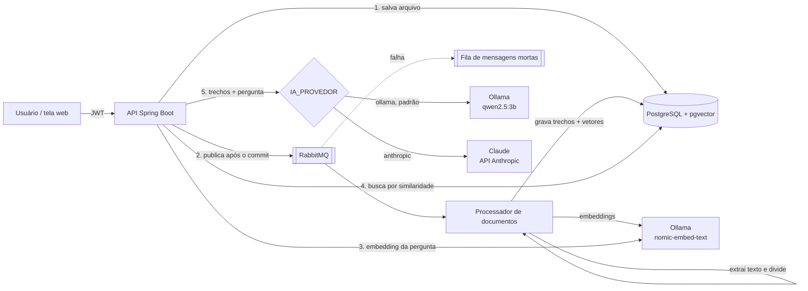

# Base de Conhecimento com RAG

API em **Java 21 + Spring Boot** que recebe documentos (PDF, Markdown, texto) e responde perguntas sobre eles
usando **RAG** (*Retrieval-Augmented Generation*): busca semântica com **pgvector** e resposta gerada por um
modelo de linguagem, sempre citando de qual trecho veio cada informação.

**Roda 100% grátis e local** com o Ollama (modelo `qwen2.5:3b`). Mudando uma variável, as respostas passam a
vir do **Claude** (API da Anthropic, paga por uso).

> Projeto desenvolvido junto com IA (Claude) como ferramenta de apoio. As decisões de arquitetura estão
> documentadas em [`docs/adr`](docs/adr) e o que eu preciso saber explicar está em
> [`docs/perguntas-de-entrevista.md`](docs/perguntas-de-entrevista.md).

## O que o sistema faz

1. Um **administrador** envia um documento. A API salva o arquivo e responde na hora (status `PENDENTE`).
2. Uma **mensagem vai para o RabbitMQ**. Um processador em segundo plano extrai o texto, divide em trechos,
   gera um *embedding* de cada trecho com o **Ollama** (modelo `nomic-embed-text`, local e gratuito)
   e grava no **PostgreSQL + pgvector**. O status vira `PRONTO`.
3. Um **usuário** faz uma pergunta. A API gera o embedding da pergunta, busca os 4 trechos mais parecidos
   e envia esses trechos para o **modelo de linguagem** (Ollama local ou Claude), com instruções para responder **só** com base neles e citar a fonte.
4. A resposta do modelo é **validada** antes de chegar ao usuário. Se o modelo estiver fora do ar ou a
   resposta for inválida, o sistema devolve os trechos encontrados (plano B), em vez de um erro.

## Arquitetura



## Destaques técnicos

| Tema | Como foi resolvido |
|---|---|
| Busca semântica | `pgvector` com índice **HNSW** e distância de cosseno; SQL escrito à mão em `RepositorioTrechos` |
| Processamento assíncrono | **RabbitMQ** com fila de mensagens mortas (DLQ); a API não espera o Ollama |
| Consistência banco ↔ fila | Mensagem publicada **só depois do commit** (`@TransactionalEventListener(AFTER_COMMIT)`) |
| Idempotência | Mensagem repetida não duplica trechos; documento `PRONTO` é ignorado; arquivo repetido é recusado pelo hash SHA-256 |
| Confiabilidade da IA | Validação das citações, plano B quando o modelo falha, "não sei" quando não há contexto (sem chamar o modelo) |
| Prompt injection | Trechos entram delimitados e marcados como material de consulta, não como instruções |
| Segurança | Spring Security sem sessão, **JWT**, senhas com **BCrypt**, papéis `ADMIN` e `USUARIO` |
| Custo | **Limite de perguntas por usuário** (janela deslizante) e **cache** de respostas com expiração |
| Desacoplamento da IA | Interfaces `GeradorDeEmbeddings` e `ModeloDeLinguagem`; o provedor da resposta (Ollama ou Claude) é escolhido por configuração (`IA_PROVEDOR`) |
| Observabilidade | Actuator + **Prometheus**: tempo de embedding, de busca e do LLM; respostas por modo; acertos de cache |
| Qualidade da IA | **Conjunto de avaliação** com 13 perguntas e respostas esperadas ([`avaliacao/`](avaliacao)) |
| Testes | JUnit + **Testcontainers** (PostgreSQL e RabbitMQ reais), IA substituída por versões falsas determinísticas |
| Banco versionado | **Flyway** |
| Entrega | **Docker Compose** (sobe tudo com um comando) e **GitHub Actions** |

## Como rodar

Pré-requisito: **Docker**. Reserve uns 4 GB de disco para os modelos e 8 GB de RAM no computador.

```bash
cp .env.example .env          # preencha JWT_SEGREDO, ADMIN_EMAIL e ADMIN_SENHA
docker compose up -d --build  # a primeira vez demora: baixa imagens e os modelos do Ollama (~2,3 GB)
./scripts/carregar-exemplos.sh
```

Abra **http://localhost:8080**, entre com o e-mail e a senha de admin do `.env` e pergunte, por exemplo,
"Quantos dias de férias eu tenho?".

A primeira pergunta pode levar mais tempo, porque o Ollama carrega o modelo na memória.

### Usar o Claude em vez do modelo local

No `.env`, troque `IA_PROVEDOR=anthropic`, preencha `ANTHROPIC_API_KEY` (crie em
[console.anthropic.com](https://console.anthropic.com), pago por uso) e rode `docker compose up -d` de novo.
As respostas ficam mais rápidas e mais precisas. Os embeddings continuam no Ollama, de graça.

Outros endereços:
- Painel do RabbitMQ: http://localhost:15672 (guest / guest)
- Métricas: http://localhost:8080/actuator/prometheus

### Rodar fora do Docker (para desenvolver)

```bash
docker compose up -d postgres rabbitmq ollama ollama-baixar-modelo
export ADMIN_EMAIL=admin@exemplo.com ADMIN_SENHA=uma-senha
mvn spring-boot:run
```

### Testes

```bash
mvn verify   # unitários + integração (precisa do Docker rodando, por causa do Testcontainers)
```

## API

| Método | Rota | Quem | Descrição |
|---|---|---|---|
| POST | `/api/auth/registrar` | público | Cria conta de usuário comum |
| POST | `/api/auth/entrar` | público | Devolve o token JWT |
| GET | `/api/auth/eu` | logado | Dados do usuário do token |
| POST | `/api/documentos` | ADMIN | Envia arquivo (`multipart`: `arquivo`, `titulo`) → 201 `PENDENTE` |
| GET | `/api/documentos` | logado | Lista documentos e status |
| GET | `/api/documentos/{id}` | logado | Detalhe de um documento |
| POST | `/api/documentos/{id}/reprocessar` | ADMIN | Recoloca na fila um documento que falhou |
| DELETE | `/api/documentos/{id}` | ADMIN | Remove documento e trechos |
| POST | `/api/perguntas` | logado | `{"pergunta": "..."}` → resposta, modo e fontes |

Exemplo de resposta de `/api/perguntas`:

```json
{
  "resposta": "Você tem direito a 30 dias de férias a cada 12 meses de trabalho [1], que podem ser divididas em até três períodos [1].",
  "modo": "COMPLETA",
  "fontes": [
    { "numero": 1, "documento": "Manual de RH", "trecho": 1, "similaridade": 0.78, "citada": true, "conteudo": "..." }
  ],
  "doCache": false
}
```

`modo` pode ser `COMPLETA`, `SOMENTE_TRECHOS` (modelo indisponível ou resposta rejeitada) ou `SEM_CONTEXTO`.

## Estrutura

```
src/main/java/.../conhecimento
├── auth/        JWT, filtro, cadastro e login, criação do admin
├── documento/   upload, fila, processador, divisão em trechos, repositório vetorial
├── pergunta/    fluxo RAG, prompt, validação, cache, limite de requisições
├── ia/          interfaces e adaptadores para Claude e Ollama
├── avaliacao/   executor do conjunto de avaliação
├── config/      segurança, RabbitMQ, propriedades
└── comum/       exceções e tratamento de erros (ProblemDetail)
```

## Limitações conhecidas e próximos passos

- Cache e limite de requisições ficam **na memória de cada instância**. Com mais de uma instância, o próximo passo é usar **Redis**.
- Se o RabbitMQ estiver fora do ar no momento do envio, o documento fica `PENDENTE` até alguém usar "reprocessar".
  A solução completa seria o padrão **Transactional Outbox**.
- PDFs escaneados (imagem) não têm texto extraível; precisariam de OCR.
- Divisão de texto por tamanho em caracteres; uma melhoria seria dividir por tokens ou por seções do Markdown.
- O modelo local pequeno (3B) segue as instruções pior que o Claude: com ele, o modo `SOMENTE_TRECHOS`
  (resposta recusada pela validação) aparece com mais frequência. Compare os dois com o conjunto de avaliação.
- Busca só semântica; combinar com busca por palavra-chave (**busca híbrida**) costuma melhorar perguntas com códigos e números.
